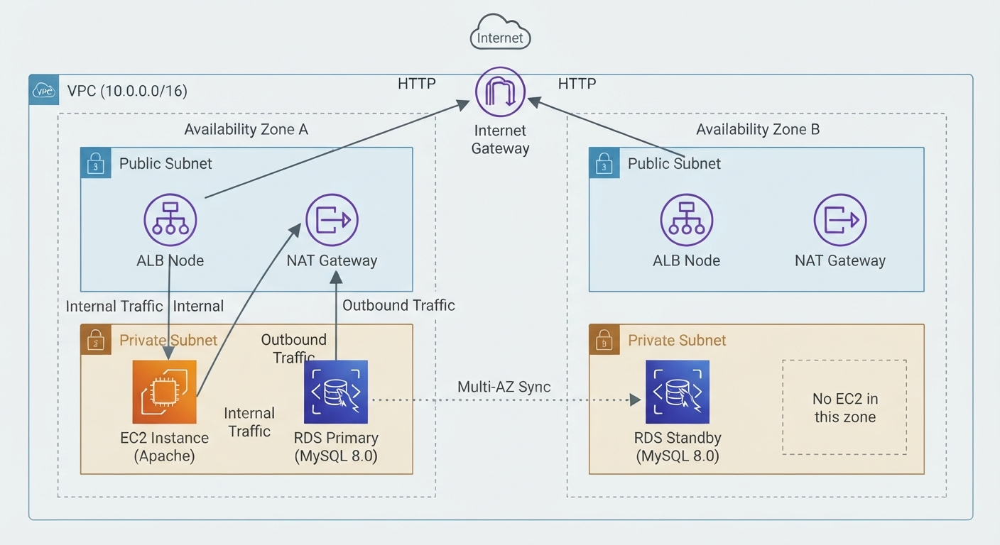
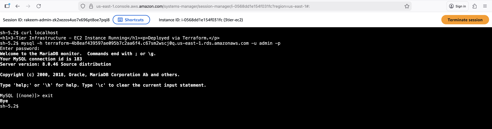
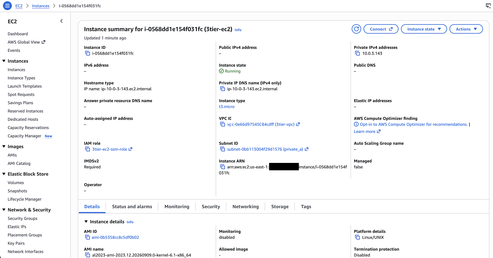
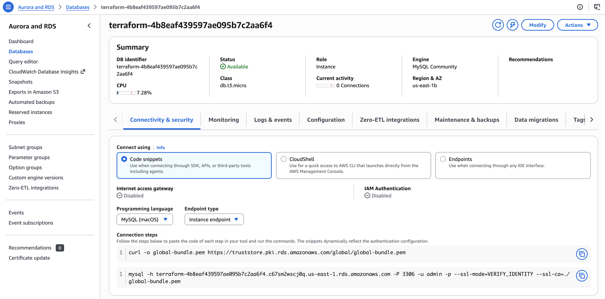
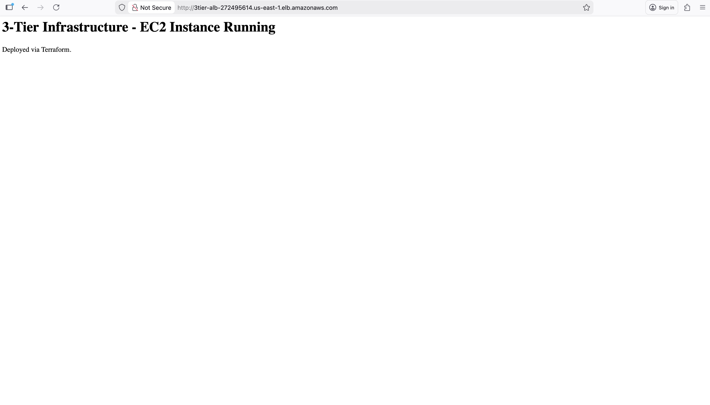

# AWS 3-Tier Infrastructure (Terraform)

A 3-tier AWS architecture — VPC, EC2, RDS, and an Application Load Balancer — built from scratch in Terraform, deployed to real AWS infrastructure, and verified end-to-end.

This is a rebuild of an [earlier version](https://github.com/RakeemDodd/Terraform-3tier-AWS) of this project, done independently using the official Terraform provider docs as the primary reference, with the goal of fully understanding and being able to defend every component rather than copying a pattern.

> **Status:** Part A (team-grade infrastructure as code) is in progress: remote state, modules, dev and prod environments, and a CI/CD pipeline. The original Stage 1 version is preserved as the [v1.0-flat release](https://github.com/RakeemDodd/aws-3tier-infrastructure/releases/tag/v1.0-flat). Plan and decisions: [docs/PART_A_PLAN.md](docs/PART_A_PLAN.md).

**[Read the full build log →](./BUILD_LOG.md)** — every milestone, plus the real bugs hit and fixed along the way.



## Contents

- [Architecture](#architecture)
- [Verification](#verification)
- [Project Status](#project-status)
- [Terraform Outputs](#terraform-outputs)
- [Project File Structure](#project-file-structure)
- [Tech Stack](#tech-stack)
- [Known Limitations / Next Steps](#known-limitations--next-steps)
- [Running This Yourself](#running-this-yourself)

---

## Architecture

- **VPC** (`10.0.0.0/16`) spanning 2 Availability Zones
- **4 subnets** — 2 public, 2 private, one pair per AZ
- **Internet Gateway** for public subnet traffic
- **2 NAT Gateways** (one per AZ) so private subnets can reach the internet without being reachable from it
- **Application Load Balancer** across both public subnets, routing to EC2
- **EC2 instance** in a private subnet, running Apache, provisioned entirely via Terraform `user_data`
- **RDS MySQL 8.0** with **Multi-AZ** enabled, in the private subnets
- **Security groups chained by tier** — ALB → EC2 → RDS, no open database or app-server ports
- **IAM role + instance profile** giving the EC2 instance AWS Systems Manager access, so it can be verified without SSH keys or open ports

---

## Verification

Every layer of this was actually tested against the live, deployed infrastructure — not just planned and assumed to work.

**Connected to the EC2 instance via AWS Systems Manager Session Manager and confirmed the web server and database were both live:**



**Confirmed the instance was healthy in the AWS Console:**



**Confirmed RDS was available with Multi-AZ enabled:**



**Loaded the site through the public Application Load Balancer URL, from outside AWS entirely:**



The real bugs hit and fixed during verification — an AMI variant without the SSM Agent, an AWS naming restriction, a wrong package name — are documented in full in [`BUILD_LOG.md`](./BUILD_LOG.md).

---

## Project Status

- ✅ Infrastructure deployed successfully via Terraform, no manual console steps
- ✅ Hand-written resources throughout — no black-box modules, every line is one I can explain
- ✅ EC2 ↔ RDS connection verified with a live `mysql` login, not just a security group review
- ✅ ALB verified by loading the live page from an external browser
- ✅ EC2 access verified via AWS Systems Manager — no SSH keys, no open ports
- ✅ Full teardown verified — `terraform destroy` confirmed and cross-checked in the AWS Console
- ⚙️ Not yet built: HTTPS, Secrets Manager integration, CloudWatch alarms (see [Known Limitations](#known-limitations--next-steps))

---

## Terraform Outputs

| Output | Description |
|---|---|
| `vpc_id` | ID of the created VPC |
| `public_subnet_ids` | IDs of the two public subnets |
| `private_subnet_ids` | IDs of the two private subnets |
| `ec2_private_ip` | Private IP of the EC2 instance |
| `rds_endpoint` | RDS connection endpoint (host:port) |
| `alb_dns_name` | Public DNS name of the load balancer — this is the URL to visit |
| `nat_gateway_ips` | Public IPs of the two NAT Gateways |

---

## Project File Structure

| File | Description |
|---|---|
| `vpc.tf` | VPC and DNS settings |
| `subnets.tf` | Public and private subnets across 2 AZs |
| `internet_gateway.tf` | Internet Gateway for public subnets |
| `nat_gateway.tf` | NAT Gateways and Elastic IPs for private subnet internet access |
| `route_tables.tf` | Public and private route tables and associations |
| `security_groups.tf` | Chained security groups — ALB → EC2 → RDS |
| `ec2.tf` | EC2 instance, AMI lookup, and `user_data` bootstrap script |
| `iam.tf` | IAM role and instance profile for SSM access |
| `rds.tf` | RDS MySQL instance and subnet group |
| `alb.tf` | Application Load Balancer, target group, and listener |
| `outputs.tf` | Terraform outputs |
| `variables.tf` | Input variables (e.g. database password) |
| `versions.tf` | Terraform and provider version constraints |
| `terraform.tfvars` | Sensitive values — git-ignored, never committed |
| `.gitignore` | Excludes state files, `.tfvars`, and other sensitive/generated files |
| `BUILD_LOG.md` | Full milestone and debugging log |
| `docs/PART_A_PLAN.md` | Part A plan: decisions and trade-offs |

---

## Tech Stack

- Terraform (`~> 6.0` AWS provider)
- AWS: VPC, EC2, RDS, ALB, NAT Gateway, IAM, Systems Manager
- Amazon Linux 2023

---

## Known Limitations / Next Steps

This build is scoped as a demo/learning project and intentionally leaves out a few things that would matter in a persistent production environment:

- **No HTTPS** — the ALB listener is HTTP-only. Adding this would require a registered domain and an ACM certificate, which didn't fit a short-lived demo.
- **No Secrets Manager** — the database password is passed via a git-ignored `terraform.tfvars` file rather than AWS Secrets Manager. Fine for a single-developer demo; a team environment would use Secrets Manager for rotation and access control.
- **No CloudWatch alarms/monitoring** — this infrastructure exists for a few minutes at a time for testing, not as an always-on service, so there was nothing meaningful to alert on.

---

## Running This Yourself

```bash
terraform init
terraform plan
terraform apply
```

You'll need to supply a `terraform.tfvars` file with a `db_password` variable (see `variables.tf`). Remember to `terraform destroy` when done — this creates real, billable AWS resources (primarily NAT Gateways, the ALB, and RDS Multi-AZ).

---

## Author

**Rakeem Dodd**
[GitHub Profile](https://github.com/RakeemDodd)
